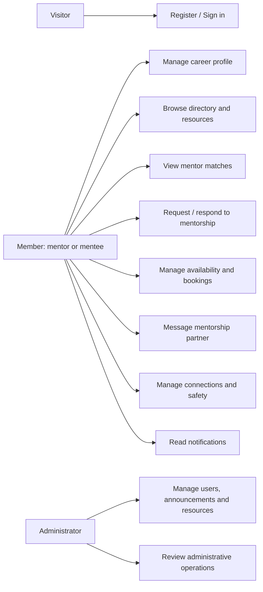
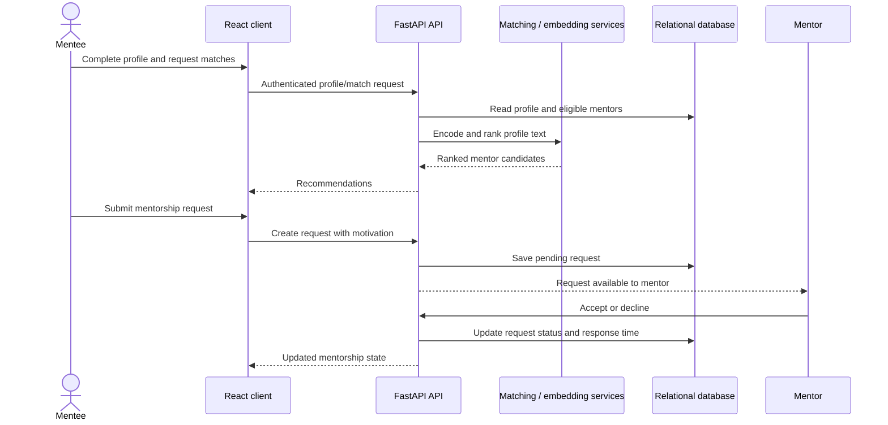
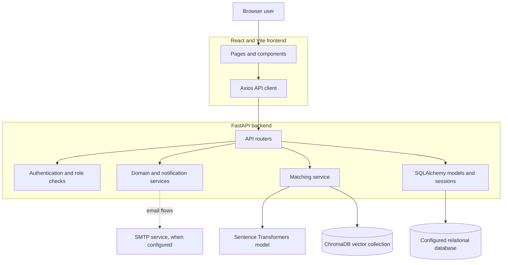
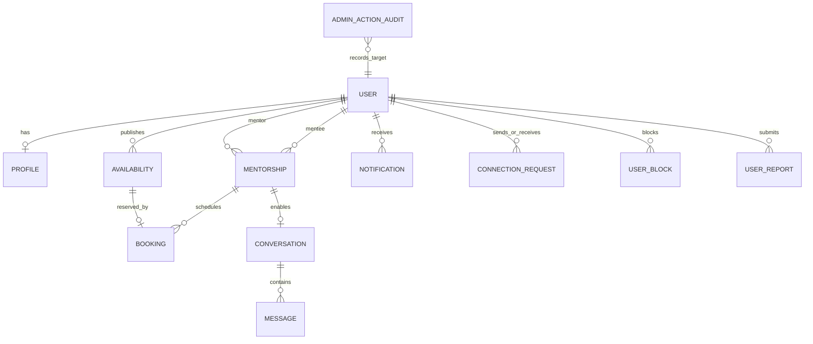

# Chapter 4: System Analysis and Design

## 4.1 Introduction

This chapter analyses and designs AlumniConnect, a web-based alumni community platform intended to help members maintain professional profiles, find relevant mentors, build connections and access career resources. The chapter states the system requirements, describes its principal users and workflows, and presents its logical architecture and data design. Object-oriented analysis and design (OOAD) is used because the system is organised around users and related entities such as profiles, mentorships, bookings, conversations and resources. The design is expressed through use cases, process flows, a component view and a relational data model.

## 4.2 System Requirements

The requirements below are derived from the features implemented in the repository. They should be checked against the approved project objectives and supervisor feedback before submission. “Verification” identifies a suitable way to demonstrate each requirement; it does not imply that the verification has already been performed.

### 4.2.1 Functional Requirements

| ID | Requirement | Priority | Verification |
|---|---|---|---|
| FR-01 | The system shall allow a visitor to register with a name, email address, password, community role and career profile. | Essential | Registration demonstration and API test |
| FR-02 | The system shall authenticate registered users and provide access according to their role. | Essential | Login and role-access tests |
| FR-03 | A member shall be able to create and update a profile containing career domain, career path, experience, skills, goals, availability and optional biography and certifications. | Essential | Profile create/update test |
| FR-04 | A member shall be able to control whether their profile appears in the member directory. | Essential | Directory visibility test |
| FR-05 | A mentee shall be able to discover and view mentor recommendations ranked using profile similarity. | Essential | Matching service/API test and demonstration |
| FR-06 | A mentee shall be able to submit a mentorship request with a motivation statement; a mentor shall be able to accept or decline a pending request. | Essential | Request lifecycle tests |
| FR-07 | A mentor shall be able to publish availability, and an eligible mentee shall be able to book an available slot associated with an accepted mentorship. | Essential | Booking workflow tests |
| FR-08 | Mentorship participants shall be able to exchange messages within their mentorship conversation. | Essential | Authenticated conversation tests |
| FR-09 | The system shall allow members to send and respond to connection requests and use community safety controls such as reporting or blocking. | Important | Network API tests and demonstration |
| FR-10 | The system shall present published career and learning resources to members. | Important | Knowledge resource retrieval test |
| FR-11 | An administrator shall be able to manage users, announcements and knowledge resources, and review administrative operations. | Important | Admin role and CRUD tests |
| FR-12 | The system shall provide notifications for supported community events and allow a user to review notification status. | Important | Notification workflow test |

### 4.2.2 Non-Functional Requirements

| ID | Requirement | Verification |
|---|---|---|
| NFR-01 | Protected API operations shall require a valid access token; role-restricted operations shall reject callers without the required role. | Attempt requests with absent, invalid and insufficient-role credentials. |
| NFR-02 | Passwords shall be stored as password hashes rather than plaintext. | Inspect persistence and authentication implementation; use test accounts. |
| NFR-03 | The system shall validate submitted data and return an error response for invalid or unauthorized operations without creating an invalid record. | Boundary and negative API tests. |
| NFR-04 | Persistent records shall use relational keys and constraints for core relationships and state values where defined. | Inspect schema and test constraint behavior. |
| NFR-05 | The web client shall communicate with the backend through the documented HTTP API and shall present success or error feedback for user actions. | End-to-end demonstration across supported workflows. |
| NFR-06 | The application shall support the configured deployment environment and external-service settings without embedding credentials in source code. | Clean-environment configuration review and deployment test. |

No response-time, availability, accessibility-conformance or scale targets are specified in the available project materials. These should be added only after the project environment and evaluation method have been agreed and measured.

### 4.2.3 Data Requirements

The system stores account identity and role, profile attributes, mentorship requests and statuses, mentor availability, bookings, conversations and messages, notifications, connection and safety records, announcements, knowledge resources, and administrative audit information. User and profile data are linked by a one-to-one relationship. Mentorship, booking, messaging and notification records reference the relevant user or workflow records through foreign keys.

Profile skills and certifications are collected as member-provided career information. The system uses these profile attributes to construct text for semantic mentor matching. The project should collect only information needed for community and matching functions, restrict access according to user role and visibility settings, and avoid including credentials or private test data in the report or repository. The available repository does not define a formal retention schedule, backup policy or deletion procedure; these are operational matters to confirm before a real deployment.

### 4.2.4 Interface and Integration Requirements

AlumniConnect has a browser-based React client and a FastAPI backend exposing HTTP endpoints. The client uses Axios for API communication. The backend persists structured application data through SQLAlchemy and a configured relational database, and uses ChromaDB for persistent mentor-vector data. The embedding service loads a Sentence Transformers model from the configured path. Email verification and password-reset flows can use SMTP settings. These services depend on environment configuration; availability and behavior when an external service is unavailable should be tested in the target deployment.

## 4.3 System Analysis

### 4.3.1 Actors and Use Cases

The main actors are a visitor, a registered member (mentor or mentee), and an administrator. A visitor registers or signs in. A member manages a profile, searches the directory and resources, requests or provides mentorship, books sessions, communicates with a mentorship partner, manages connections and reads notifications. An administrator manages community content and user operations. The administrative role is protected separately from normal member capabilities.

### 4.3.2 Main Process: Mentor Discovery and Mentorship

The mentee first creates a career profile. The matching service converts profile attributes into text and generates a normalized embedding. Candidate mentors are ranked using similarity, and recommendations are presented for the mentee to review. The mentee may submit a request and motivation to a selected mentor. The request remains pending until the mentor accepts or declines it. Once an accepted mentorship exists, the participants can use the associated conversation; booking functions relate available mentor time to that mentorship.

## 4.4 System Design

### 4.4.1 Architecture

The application uses a client-server architecture. The React single-page client presents the user workflows and calls the FastAPI REST API. API routers implement authentication, profiles, matching, mentorship, bookings, chat, notifications, networking, knowledge resources and administration. SQLAlchemy models persist structured records in the configured database. Matching uses a Sentence Transformers embedding model and ChromaDB persistent collection for semantic mentor search. SMTP is an optional configured integration for email-related flows.

### 4.4.2 Data Model

The core data model separates account identity from career profile and represents each community workflow as related records. A user has one profile. Mentorship records connect a mentee and mentor and carry a status and motivation. Availability belongs to a mentor; a booking references an availability slot and mentorship. Conversations belong to a mentorship and contain messages. Notifications belong to a user. Separate entities represent network connections, blocks, reports, announcements, resources and administrator actions.

The exact physical schema is defined by the SQLAlchemy models and database configuration. The diagram is a logical summary; it omits some audit and content attributes for readability. A persistent vector collection stores mentor embeddings keyed by mentor identifier, while the relational store remains the source for profile and workflow records.

### 4.4.3 Security and Access Design

Authentication uses password hashing and signed bearer tokens. Protected endpoints identify the current user and apply role or ownership checks for sensitive actions. The design also includes email verification, account activity state, admin bootstrap auditing and administrative action records. Directory visibility is controlled at profile level. These controls reduce unauthorized access paths, but the presence of controls in code is not a substitute for a full security assessment. Production deployment should use a strong secret, HTTPS, restricted database access and configured secrets outside version control.

## 4.5 Chapter Summary

This chapter translated the implemented AlumniConnect scope into functional, quality, data and integration requirements, then described its actors, principal mentorship process, client-server architecture, data relationships and access-control approach. Chapter 5 documents implementation and presents the verification and evaluation evidence available for these requirements.

# Chapter 5: System Implementation and Evaluation

## 5.1 Introduction

This chapter describes the implementation of AlumniConnect and the evidence available for assessing it. The system is implemented as a React browser client backed by a FastAPI service, a relational database, and a semantic mentor-matching subsystem using Sentence Transformers and ChromaDB. The repository contains automated backend tests for several workflows. No user-study dataset, performance benchmark, deployment report or consolidated test-run results were present in the materials inspected; therefore, this chapter distinguishes implemented behavior and test coverage from measured outcomes that must be added from the final project evaluation.

## 5.2 Implementation Environment

| Layer | Technologies evidenced in repository | Configuration note |
|---|---|---|
| Frontend | React 19, React Router, Axios, Vite | Version ranges are defined in `frontend/package.json`; a browser is required. |
| Backend | Python, FastAPI, SQLAlchemy, Pydantic | Exact pinned Python package versions are listed in `backend/requirements.txt`. |
| Relational persistence | SQLAlchemy with configured database URL | The actual engine is selected by the `DATABASE_URL` setting. |
| Mentor search | Sentence Transformers and ChromaDB | Model path and vector-store path are configured through settings. |
| Optional email | SMTP integration | SMTP host, port, credentials and sender are environment settings. |

The repository does not provide a complete deployment specification or tested minimum hardware profile. Record the actual operating system, Python and Node versions, database product/version, embedding model identity, and hardware used for the final demonstration before submission. Do not include secret values in the report.

## 5.3 Implemented Modules

### 5.3.1 Accounts and Profiles

The authentication module supports registration and login, password hashing, bearer-token authentication, and email verification and password-reset flows. User records distinguish administrator access from community role. Profile records contain career domain, path, experience, skills, certifications, goals, mentorship interests, availability, biography, profile picture URL and directory visibility.

### 5.3.2 Mentor Matching

The matching service builds text from profile fields, encodes the text with a configured Sentence Transformers model using normalized embeddings, and compares profile vectors. A ranking path sorts mentors by similarity score; the vector-store service supports persistent mentor upsert, lookup and nearest-neighbor search in a ChromaDB collection configured for cosine distance. Matching is a relevance aid based on entered profile content. No labeled outcome study or independent quality benchmark is available, so recommendation quality should not be presented as validated.

### 5.3.3 Mentorship, Scheduling and Communication

Mentorship requests store a mentee, mentor, motivation and status. The API enforces authenticated request creation, rejects invalid mentor identifiers and duplicate active requests, and restricts responses to the addressed mentor and pending requests. Mentors can publish availability; bookings associate an availability slot with an accepted mentorship and a mentee. A mentorship conversation stores messages and sender/read timestamps. Notifications surface supported events to users.

### 5.3.4 Networking, Resources and Administration

The networking module provides connection requests and community safety records. The knowledge module exposes published career resources; administrators can manage community content and user operations through protected routes. Administrative bootstrap and action audit models support traceability of sensitive administrative actions. The frontend contains corresponding pages for member, mentor and administrator workflows.

## 5.4 Data and Integration Implementation

Structured application data is represented by SQLAlchemy models with foreign keys, uniqueness constraints and status constraints where defined. The backend creates database tables from model metadata and includes compatibility adjustments for selected legacy schema changes at startup. The vector store is a separate persistent component keyed by mentor identifier. The frontend calls the API over HTTP; local development CORS settings permit the Vite development origins. SMTP-dependent flows require valid mail-server settings. A deployment outside local development must configure the allowed origins and external services for its environment.

## 5.5 Verification Approach and Evidence

The repository includes pytest tests for authentication, profiles, mentor matching, mentorship, chat, admin operations, vector storage and related API behavior. The visible matching unit tests check ranking order, score conversion, inclusion of candidate mentors and empty-candidate behavior. Mentorship API tests cover authentication, request creation, duplicate prevention, invalid mentors, role restrictions and mentor decisions. These tests are evidence of defined behavior when executed successfully; source files alone do not establish the outcome of the latest test run.

| Area | Evidence in repository | Result to report after execution |
|---|---|---|
| Authentication and profiles | `backend/tests/test_auth.py`, `backend/tests/test_profiles_api.py` | Test count, pass/fail, environment and date |
| Matching | `backend/tests/test_matching.py`, `backend/tests/test_matching_api.py`, vector-store tests | Test count and any real-model evaluation protocol |
| Mentorship | `backend/tests/test_mentorship.py` | Test count, pass/fail and defects/retests |
| Chat and notifications | Corresponding backend test modules | Test count and pass/fail |
| Administration and network | Admin and related API test modules | Test count, pass/fail and access-control cases |
| Browser workflows | Frontend pages and components | Manual or automated end-to-end scenarios and observed outcomes |

For the final report, run the agreed test suite and replace the final column with actual recorded output. Add the actual evaluation date, environment, number of cases, failures, fixes and retests. If user acceptance is part of the project objectives, describe participants, consent, tasks, instrument and results only when those data have been collected.

## 5.6 Evaluation Results and Discussion

The implementation evidence demonstrates that the repository contains modules for the principal requirements: account and profile management, mentor discovery, mentorship requests, scheduling, communication, networking, knowledge resources and administration. Existing tests encode expected behaviors for core API and service paths. A quantitative requirement-coverage percentage cannot be calculated reliably from the source listing alone because the final approved requirements, complete test execution record and acceptance criteria are not supplied here.

The matching implementation uses semantic profile embeddings and cosine-based search. This establishes the implemented method, not its effectiveness for real alumni outcomes. Evaluation should compare recommendations against a documented relevance judgment or user feedback, specify the profile sample and model version, and report appropriate ranking measures or task outcomes. Likewise, no response-time, concurrency, usability, reliability or security-test measurements are available in the inspected materials. Do not claim those quality attributes have met thresholds until measured under stated conditions.

Important limitations for interpretation are the absence of documented user-study findings, deployment measurements, representative alumni data and a formal retention/backup policy. The recommendation service depends on the quality and completeness of profile text and the configured embedding model. External email delivery depends on SMTP configuration. The available evidence therefore supports a description of implemented functionality and encoded test expectations, but not a claim of validated adoption, production scalability or recommendation quality.

## 5.7 Chapter Summary

This chapter described the implementation architecture and modules, data persistence and integrations, and the verification evidence present in the repository. It separated code-level implementation and test definitions from empirical evaluation results that still require actual execution or participant evidence. Chapter 6 draws conclusions within those evidence boundaries and identifies focused next steps.

# Chapter 6: Conclusions, Recommendations and Future Work

## 6.1 Introduction

This chapter concludes the AlumniConnect project from the implementation and verification evidence described in Chapter 5. It summarises what the software provides, recommends actions for responsible completion and deployment, and identifies evaluation and development work that remains open. The conclusions are limited to the inspected implementation and repository evidence.

## 6.2 Conclusions

AlumniConnect implements a web-based foundation for alumni engagement through career profiles, mentor discovery, mentorship requests, scheduling, messaging, community networking, notifications, career resources and administrative functions. Its design combines a React client, FastAPI API, relational persistence and a semantic mentor-matching subsystem based on profile embeddings and ChromaDB search.

The project has encoded expected behavior for important backend workflows in automated tests, including mentor ranking and mentorship request rules. This supports the conclusion that the system has been designed with testable service and access-control behavior. Because the available materials do not include the latest test execution report, measured usability or performance results, representative user feedback, or an evaluation of recommendation relevance, the evidence does not establish that all requirements have passed acceptance or that the platform is ready for production use.

The project's contribution is an integrated software prototype connecting alumni profile information with mentoring, networking and career-resource workflows. This conclusion applies to the code and test definitions present in the repository; effectiveness with a real alumni population and operational suitability remain to be established through deployment and evaluation.

## 6.3 Recommendations

1. **Project team:** Execute the complete backend test suite and documented frontend scenarios in a clean, recorded environment. Publish pass/fail totals, defects, fixes and retests so requirement coverage is evidence-based.
2. **Project team and supervisor:** Evaluate the mentor recommendations with representative profiles and documented relevance judgments or participant feedback. Report the model identity, data sample, evaluation method and limitations before making claims about matching quality.
3. **Deployment administrator:** Before any live deployment, configure strong secrets, HTTPS, production CORS origins, restricted database access, SMTP credentials and backup/restore procedures. Verify account roles, ownership checks and administrative audit behavior in the deployment environment.
4. **Community administrators:** Establish clear profile visibility, data retention, deletion and incident-handling practices. These policies should be communicated to members because the platform processes profile and communication data.
5. **Evaluation team:** Measure usability and key workflow completion with intended alumni users, and record response times and failure behavior under an agreed workload before setting service-level targets.

## 6.4 Future Work

Future evaluation should first test the platform with a broader and representative alumni group. This would reveal whether the profile fields, directory controls and mentoring workflows fit actual users; success can be assessed through task completion, feedback and observed workflow problems.

The mentor-matching subsystem could be evaluated against human judgments and alternative ranking baselines. A later study could examine profile completeness, recommendation relevance across career domains, and the effect of explicit user feedback. Any change to the embedding model should be compared under the same data and evaluation protocol.

Further engineering work should include deployment hardening and operational evaluation: backup restoration, email-provider failure handling, load behavior, accessibility review, and documented data lifecycle controls. These activities address deployment and assurance gaps identified in the available project evidence and should be prioritised according to the intended adoption context.

## 6.5 Final Statement

AlumniConnect provides an implemented technical foundation for connecting alumni through mentoring and professional community features. The next stage is to complete reproducible verification and user-centered evaluation, then use that evidence to decide what deployment safeguards and product changes are justified.
