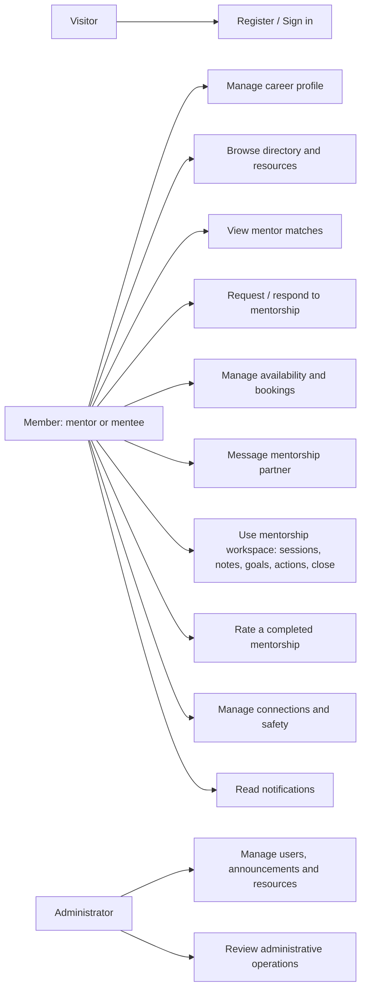
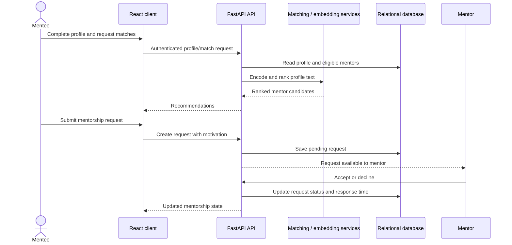
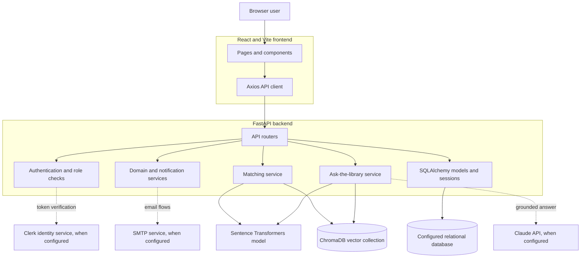
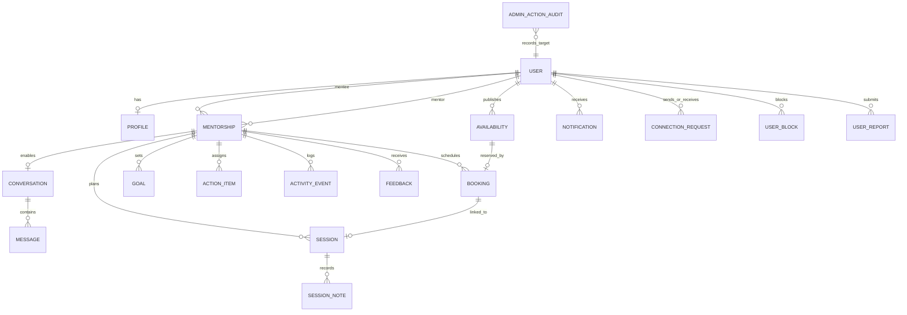

# Chapter 4: System Analysis and Design

## 4.1 Introduction

This chapter analyses and designs AlumniConnect, a web-based alumni community platform intended to help members maintain professional profiles, find relevant mentors, build connections and access career resources. The chapter states the system requirements, describes its principal users and workflows, and presents its logical architecture and data design. Object-oriented analysis and design (OOAD) is used because the system is organised around users and related entities such as profiles, mentorships, bookings, conversations and resources. The design is expressed through use cases, process flows, a component view and a relational data model. Requirements were elicited and refined through the Design Thinking stages described in Section 3.4 and were built in Scrum sprints (Section 3.3), so each requirement below traces to a sprint increment.

## 4.2 System Requirements

The requirements below are derived from the features implemented in the repository. They should be checked against the approved project objectives and supervisor feedback before submission. “Verification” identifies a suitable way to demonstrate each requirement; it does not imply that the verification has already been performed.

### 4.2.1 Functional Requirements

| ID | Requirement | Priority | Verification |
|---|---|---|---|
| FR-01 | The system shall allow a visitor to register with a name, email address, password, community role and career profile. | Essential | Registration demonstration and API test |
| FR-02 | The system shall authenticate registered users and provide access according to their role. | Essential | Login and role-access tests |
| FR-03 | A member shall be able to create and update a profile containing career domain, career path, experience, skills, goals, availability and optional biography and certifications. | Essential | Profile create/update test |
| FR-04 | A member shall be able to control whether their profile appears in the member directory. | Essential | Directory visibility test |
| FR-05 | A mentee shall be able to discover and view mentor recommendations ranked using profile similarity. | Essential | Matching service/API test and demonstration |
| FR-06 | A mentee shall be able to submit a mentorship request with a motivation statement; a mentor shall be able to accept or decline a pending request. | Essential | Request lifecycle tests |
| FR-07 | A mentor shall be able to publish availability, and an eligible mentee shall be able to book an available slot associated with an accepted mentorship. | Essential | Booking workflow tests |
| FR-08 | Mentorship participants shall be able to exchange messages within their mentorship conversation. | Essential | Authenticated conversation tests |
| FR-09 | The system shall allow members to send and respond to connection requests and use community safety controls such as reporting or blocking. | Important | Network API tests and demonstration |
| FR-10 | The system shall present published career and learning resources to members. | Important | Knowledge resource retrieval test |
| FR-11 | An administrator shall be able to manage users, announcements and knowledge resources, and review administrative operations. | Important | Admin role and CRUD tests |
| FR-12 | The system shall provide notifications for supported community events and allow a user to review notification status. | Important | Notification workflow test |
| FR-13 | Participants of an accepted mentorship shall have a workspace in which they can schedule sessions, record shared or private session notes, set goals, assign action items, view progress and a timeline, and close the mentorship with an optional outcome summary. | Essential | `test_workspace` module and demonstration |
| FR-14 | After a mentorship is completed, each participant shall be able to give one 1 to 5 rating and optional comment that the other participant cannot see; administrators shall see only the count and average. | Important | Feedback tests |
| FR-15 | The system shall show, for each recommended mentor, a short descriptive list of shared skills, domain, path and goal words, without altering the ranking. | Important | Matching API test |
| FR-16 | The system shall remind a member of a session starting within 24 hours and of an open action item past its due date. | Important | Reminder test |
| FR-17 | A signed-in member shall be able to ask a natural-language question and receive an answer generated only from published library resources and announcements, with the sources used; when the library holds no relevant passage the system shall say so without calling the language model. | Important | `test_knowledge_rag` module and retrieval evaluation |

### 4.2.2 Non-Functional Requirements

| ID | Requirement | Verification |
|---|---|---|
| NFR-01 | Protected API operations shall require a valid access token; role-restricted operations shall reject callers without the required role. | Attempt requests with absent, invalid and insufficient-role credentials. |
| NFR-02 | Passwords shall be stored as password hashes rather than plaintext. | Inspect persistence and authentication implementation; use test accounts. |
| NFR-03 | The system shall validate submitted data and return an error response for invalid or unauthorized operations without creating an invalid record. | Boundary and negative API tests. |
| NFR-04 | Persistent records shall use relational keys and constraints for core relationships and state values where defined. | Inspect schema and test constraint behavior. |
| NFR-05 | The web client shall communicate with the backend through the documented HTTP API and shall present success or error feedback for user actions. | End-to-end demonstration across supported workflows. |
| NFR-06 | The application shall support the configured deployment environment and external-service settings without embedding credentials in source code. | Clean-environment configuration review and deployment test. |
| NFR-07 | Workspace data shall be visible only to the two participants of the mentorship; any other caller, including an administrator, shall receive a not-found response. Private notes shall be returned only to their author. | Access tests with non-participant, administrator and counterpart callers. |
| NFR-08 | Workspace writes shall be limited to 200 per member per hour. | Rate-limit test. |
| NFR-09 | Only published, admin-curated text shall be indexed for question answering and sent to the language model; member profiles, messages, mentorship notes and goals shall never be sent. Questions shall be limited to 30 per member per hour. | Index and rate-limit tests; code inspection of what is indexed. |

No response-time, availability, accessibility-conformance or scale targets are specified in the available project materials. These should be added only after the project environment and evaluation method have been agreed and measured.

### 4.2.3 Data Requirements

The system stores account identity and role, profile attributes, mentorship requests and statuses, mentor availability, bookings, conversations and messages, notifications, connection and safety records, announcements, knowledge resources, and administrative audit information. The mentorship workspace adds sessions, session notes, goals, action items, an activity timeline and closure feedback, all keyed to a mentorship. User and profile data are linked by a one-to-one relationship. Mentorship, booking, messaging and notification records reference the relevant user or workflow records through foreign keys.

Profile skills and certifications are collected as member-provided career information. The system uses these profile attributes to construct text for semantic mentor matching. The project should collect only information needed for community and matching functions, restrict access according to user role and visibility settings, and avoid including credentials or private test data in the report or repository. The available repository does not define a formal retention schedule, backup policy or deletion procedure; these are operational matters to confirm before a real deployment.

### 4.2.4 Interface and Integration Requirements

AlumniConnect has a browser-based React client and a FastAPI backend exposing HTTP endpoints. The client uses Axios for API communication. The backend persists structured application data through SQLAlchemy and a configured relational database, and uses ChromaDB for persistent mentor-vector data. The embedding service loads a Sentence Transformers model from the configured path. Email verification and password-reset flows can use SMTP settings. These services depend on environment configuration; availability and behavior when an external service is unavailable should be tested in the target deployment.

## 4.3 System Analysis

### 4.3.1 Actors and Use Cases

The main actors are a visitor, a registered member (mentor or mentee), and an administrator. A visitor registers or signs in. A member manages a profile, searches the directory and resources, requests or provides mentorship, books sessions, communicates with a mentorship partner, manages connections and reads notifications. An administrator manages community content and user operations. The administrative role is protected separately from normal member capabilities.

### 4.3.2 Main Process: Mentor Discovery and Mentorship

The mentee first creates a career profile. The matching service converts profile attributes into text and generates a normalized embedding. Candidate mentors are ranked using similarity, and recommendations are presented for the mentee to review. The mentee may submit a request and motivation to a selected mentor. The request remains pending until the mentor accepts or declines it. Once an accepted mentorship exists, the participants can use the associated conversation; booking functions relate available mentor time to that mentorship.

## 4.4 System Design

### 4.4.1 Architecture

The application uses a client-server architecture. The React single-page client presents the user workflows and calls the FastAPI REST API. API routers implement authentication, profiles, matching, mentorship, bookings, chat, notifications, networking, knowledge resources and administration. SQLAlchemy models persist structured records in the configured database. Matching uses a Sentence Transformers embedding model and ChromaDB persistent collection for semantic mentor search. A second ChromaDB collection holds embeddings of published library resources and announcements for "Ask the library": the question is embedded, the closest passages are retrieved, and a Claude model (Anthropic API) is asked to answer only from those passages, citing them (retrieval-augmented generation). SMTP is an optional configured integration for email-related flows. Clerk is an optional external identity provider: when configured, the client obtains a Clerk session token and the backend verifies it before mapping it to a local user.

### 4.4.2 Data Model

The core data model separates account identity from career profile and represents each community workflow as related records. A user has one profile. Mentorship records connect a mentee and mentor and carry a status and motivation. Availability belongs to a mentor; a booking references an availability slot and mentorship. Conversations belong to a mentorship and contain messages. Notifications belong to a user. Separate entities represent network connections, blocks, reports, announcements, resources and administrator actions.

The exact physical schema is defined by the SQLAlchemy models and database configuration. The diagram is a logical summary; it omits some audit and content attributes for readability. A persistent vector collection stores mentor embeddings keyed by mentor identifier, while the relational store remains the source for profile and workflow records.

### 4.4.3 Security and Access Design

Authentication uses password hashing and signed bearer tokens. Protected endpoints identify the current user and apply role or ownership checks for sensitive actions. Password sign-in is followed by a second step: a six-digit one-time code sent by email (login challenge records, configurable). The design also includes email verification, password reset tokens, account activity state, admin bootstrap auditing and administrative action records. Directory visibility is controlled at profile level. Every workspace route loads the mentorship, requires the caller to be its mentor or mentee and requires status `accepted` or `completed`; other callers receive 404 so identifiers cannot be probed, and administrators gain no extra access. Private notes are filtered in a single query used by every endpoint that returns notes. These controls reduce unauthorized access paths, but the presence of controls in code is not a substitute for a full security assessment. Production deployment should use a strong secret, HTTPS, restricted database access and configured secrets outside version control.

## 4.5 Chapter Summary

This chapter translated the implemented AlumniConnect scope into functional, quality, data and integration requirements, then described its actors, principal mentorship process, client-server architecture, data relationships and access-control approach. Chapter 5 documents implementation and presents the verification and evaluation evidence available for these requirements.

# Chapter 5: System Implementation and Evaluation

## 5.1 Introduction

This chapter describes the implementation of AlumniConnect and the evidence available for assessing it. The system is implemented as a React browser client backed by a FastAPI service, a relational database, and a semantic mentor-matching subsystem using Sentence Transformers and ChromaDB. The repository contains 130 automated backend tests, a frontend lint and build check, a continuous-integration workflow, and a small mentor-matching evaluation. Measured results are in Sections 5.5 and 5.6 and in `docs/evidence/`. No user-study, performance, deployment or security-test measurements have been collected yet; the chapter states this explicitly rather than implying them.

## 5.2 Implementation Environment

| Layer | Technologies evidenced in repository | Configuration note |
|---|---|---|
| Frontend | React 19, React Router, Axios, Vite | Version ranges are defined in `frontend/package.json`; a browser is required. |
| Backend | Python, FastAPI, SQLAlchemy, Pydantic | Exact pinned Python package versions are listed in `backend/requirements.txt`. |
| Relational persistence | SQLAlchemy with configured database URL | The actual engine is selected by the `DATABASE_URL` setting. |
| Mentor search | Sentence Transformers and ChromaDB | Model path and vector-store path are configured through settings. |
| Library question answering | Anthropic Python SDK 2.6.0, model set by `LLM_MODEL` (default `claude-opus-5-5`) | Optional. With `LLM_API_KEY` set, answers are generated by the model; without it the feature runs at no cost in a retrieval-only mode. |
| Optional email | SMTP integration | SMTP host, port, credentials and sender are environment settings. |

The repository does not provide a complete deployment specification or tested minimum hardware profile. Record the actual operating system, Python and Node versions, database product/version, embedding model identity, and hardware used for the final demonstration before submission. Do not include secret values in the report.

## 5.3 Implemented Modules

### 5.3.1 Accounts and Profiles

The authentication module supports registration and login, password hashing, bearer-token authentication, and email verification and password-reset flows. User records distinguish administrator access from community role. Profile records contain career domain, path, experience, skills, certifications, goals, mentorship interests, availability, biography, profile picture URL and directory visibility.

### 5.3.2 Mentor Matching

The matching service builds text from profile fields, encodes the text with a configured Sentence Transformers model using normalized embeddings, and compares profile vectors. A ranking path sorts mentors by similarity score; the vector-store service supports persistent mentor upsert, lookup and nearest-neighbor search in a ChromaDB collection configured for cosine distance. Matching is a relevance aid based on entered profile content. No labeled outcome study or independent quality benchmark is available, so recommendation quality should not be presented as validated.

### 5.3.3 Mentorship, Scheduling and Communication

Mentorship requests store a mentee, mentor, motivation and status. The API enforces authenticated request creation, rejects invalid mentor identifiers and duplicate active requests, and restricts responses to the addressed mentor and pending requests. Mentors can publish availability; bookings associate an availability slot with an accepted mentorship and a mentee. A mentorship conversation stores messages and sender/read timestamps. Notifications surface supported events to users.

### 5.3.4 Networking, Resources and Administration

The networking module provides connection requests and community safety records. The knowledge module exposes published career resources; administrators can manage community content and user operations through protected routes. Administrative bootstrap and action audit models support traceability of sensitive administrative actions. The frontend contains corresponding pages for member, mentor and administrator workflows.

### 5.3.5 Mentorship Workspace

Once a mentorship is accepted, its participants use a workspace (`backend/app/api/workspace.py`, `frontend/src/pages/workspace/`) for the mentoring lifecycle: sessions (linked to bookings, so cancelling one cancels the other and frees the slot), structured session notes that are shared or private, goals, action items, a timeline of activity events, and closure. Progress is reported as completed goals over goals not on hold and completed over all action items, shown separately and left blank when there is nothing to count; overdue items and past sessions still marked scheduled appear under "needs attention". Either participant can complete a mentorship: future sessions are cancelled, the other person is notified, nothing is deleted, the workspace becomes read-only and chat remains readable. After completion each participant may leave a private 1 to 5 rating; this is the first real outcome signal for evaluating the recommender and does not change ranking. Reminders are created when notifications are read, and the workspace is limited to 200 writes per member per hour. The matching list also returns a descriptive "why this mentor" list (`match_explanation.py`) built from the two profiles only; ranking and `similarity_score` are unchanged. Not implemented: calendar or video integration (links are stored as references), file attachments and a workspace search endpoint.

### 5.3.6 Ask the Library (Retrieval-Augmented Generation)

Members can ask a question on the Knowledge page. When an administrator publishes, edits or deletes a resource, or posts an announcement, the text is embedded with the same Sentence Transformers model used for matching and stored in a separate ChromaDB collection (`knowledge_index_service.py`); unpublished resources are removed from it, and an administrator-only reindex route rebuilds it. A question is embedded, the closest passages above a cosine-similarity floor (0.25) are retrieved, and `rag_answer.py` sends only those passages and the question to a Claude model with instructions to answer solely from them, treat them as data and not as instructions, cite them as [1], [2], and reply `NOT_IN_LIBRARY` otherwise. If no passage clears the floor, the model is not called. The response contains the answer, the cited sources and a `grounded` flag; a model refusal is reported as not grounded. Input is limited to 500 characters and 30 questions per member per hour, and a provider failure returns 502 without affecting other features. The language model is optional: when no API key is configured, the same retrieval step is used and the response is the closest resource or resources with their descriptions as written in the library (`generated: false`), so the feature costs nothing to run and cannot state anything the library does not say. The page labels generated answers as AI-generated, labels retrieval-only answers as the closest library resources, and lists sources in both cases. The answer is advisory: a human reads the cited sources and decides, in line with the human-in-the-loop principle in Section 3.2.4. Only administrator-published text leaves the system; no personal data is sent to the provider.

## 5.4 Data and Integration Implementation

Structured application data is represented by SQLAlchemy models with foreign keys, uniqueness constraints and status constraints where defined. The backend creates database tables from model metadata and includes compatibility adjustments for selected legacy schema changes at startup. The workspace migration (`workspace_migration.py`, run from `init_database()`) is idempotent and additive: it adds three nullable columns to `mentorships`, widens the status check constraint where one exists, and backfills a session for each existing booking. No migration framework such as Alembic is used yet. The vector store is a separate persistent component keyed by mentor identifier. The frontend calls the API over HTTP; local development CORS settings permit the Vite development origins. SMTP-dependent flows require valid mail-server settings. A deployment outside local development must configure the allowed origins and external services for its environment.

## 5.5 Verification Approach and Evidence

The backend has 16 pytest modules (130 tests) run against an in-memory SQLite database. The full suite was executed on 8 November 2026 on the `feature/26-mentorship-request-workflow` working tree (based on commit `366cf92`, with the workspace changes not yet committed): **130 passed, 0 failed, 0 skipped**. The earlier run of 2 November 2026 recorded 85 passed before the workspace module was added. Re-run `backend/evaluation/make_test_record.py` after committing so that the record below matches the final commit. The per-test record (module, test, expected behaviour, actual result, corrective action) is in `docs/evidence/test_record.md`, generated from the pytest JUnit report by `backend/evaluation/make_test_record.py`. The frontend passes `npm run lint` and `npm run build`. The same checks are defined in `.github/workflows/ci.yml` and run on each push and pull request.

| Area | Test modules | Result (2 Nov 2026) |
|---|---|---|
| Authentication, OTP, Clerk | `test_auth`, `test_login_otp`, `test_plus_alias_login`, `test_clerk_auth` | 25 passed |
| Profiles | `test_profiles_api` | 4 passed |
| Matching | `test_matching`, `test_matching_api`, `test_mentor_index_sync`, `test_vector_store` | 18 passed |
| Mentorship and chat | `test_mentorship`, `test_chat` | 17 passed |
| Administration and community | `test_admin_api`, `test_admin_bootstrap`, `test_community_feed` | 21 passed |
| Mentorship workspace | `test_workspace` | 35 passed |
| Ask the library | `test_knowledge_rag` | 10 passed |

The tests cover expected behaviour, authentication and role restrictions, duplicate and invalid requests (for example duplicate active mentorship requests and invalid mentor identifiers) and one-time admin bootstrap. They do not yet cover dependency failures such as an unavailable SMTP server or vector store. No frontend component or end-to-end tests exist; browser workflows still need a manual run recorded with screenshots (to be added by the author after the demonstration rehearsal).

## 5.6 Evaluation Results and Discussion

### Mentor-matching baseline evaluation

`backend/evaluation/eval_matching.py` ranks 14 synthetic mentors for 21 synthetic mentee queries (3 per career area) and compares a random ranking, a TF-IDF keyword baseline, the base `all-MiniLM-L6-v2` model and the fine-tuned model used by the application, using the production profile-text format. A mentor is relevant when they work in the same career area as the mentee (binary labels written by the author). Full output: `docs/evidence/matching_eval.md` and `.json`; the seed is fixed (42). With two relevant mentors per area, the maximum P@3 is 0.667.

| Query variant | System | P@1 | P@3 | Recall@3 | MRR |
|---|---|---|---|---|---|
| Full profile | random | 0.048 | 0.063 | 0.095 | 0.240 |
| Full profile | TF-IDF keyword | 1.000 | 0.667 | 1.000 | 1.000 |
| Full profile | base MiniLM | 1.000 | 0.667 | 1.000 | 1.000 |
| Full profile | fine-tuned | 1.000 | 0.667 | 1.000 | 1.000 |
| Skills and goals only | random | 0.190 | 0.143 | 0.214 | 0.376 |
| Skills and goals only | TF-IDF keyword | 1.000 | 0.508 | 0.762 | 1.000 |
| Skills and goals only | base MiniLM | 0.952 | 0.619 | 0.929 | 0.968 |
| Skills and goals only | fine-tuned | 0.952 | 0.635 | 0.952 | 0.968 |

**Interpretation.** All real systems far exceed random ranking, so the matching pipeline works as a relevance aid. However, this evaluation does not show that the fine-tuned model is better than a keyword baseline: with full profiles all three systems reach the ceiling, and with skills and goals only the semantic models retrieve more of the relevant mentors in the top three (Recall@3 0.93 and 0.95 against 0.76) while the keyword baseline ranks the first mentor slightly better (P@1 1.00 against 0.95). With 21 queries these differences are one or two queries and are not statistically meaningful. The dataset is small, synthetic, labelled by one person, and the queries share vocabulary with the mentor profiles, so it is too easy to separate the systems. The overlap between the fine-tuning data and these phrasings was not verified. A harder set (paraphrased queries without shared vocabulary, mentors from several overlapping areas, graded relevance labelled by a domain expert) is planned before any claim of recommendation quality.

### Ask-the-library retrieval evaluation

`backend/evaluation/eval_rag.py` evaluates the retrieval step on a synthetic library of 12 resources, 24 paraphrased questions that share few words with their answer, and 6 questions with no answer in the library (`rag_dataset.py`). No language-model calls are made. The substring row reproduces the search box that the Knowledge page had before this feature. Full output: `docs/evidence/rag_eval.md`.

| System | Hit@1 | Hit@3 | MRR | Answerable questions above floor | Out-of-library declined |
|---|---|---|---|---|---|
| substring (previous search) | 0.000 | 0.000 | 0.083 | n/a | n/a |
| TF-IDF keyword | 0.500 | 0.792 | 0.664 | n/a | n/a |
| base MiniLM | 1.000 | 1.000 | 1.000 | 1.000 | 1.000 |
| fine-tuned (production) | 0.958 | 1.000 | 0.979 | 1.000 | 1.000 |

**Interpretation.** Unlike the mentor-matching evaluation, this one separates the systems: natural-language questions rarely appear verbatim in a resource, so substring search finds nothing, TF-IDF finds the right resource first for half the questions, and the embedding models rank the right resource in the top three for every question. The 0.25 similarity floor sits between the lowest similarity of a correct document (0.45 for the fine-tuned model) and the highest similarity of an out-of-library question (0.17), so all six out-of-library questions would be declined without calling the language model. **Limits:** the library and questions are synthetic, the labels were drafted for the evaluation and need review by the author, 30 questions give coarse estimates, and the difference between the base and fine-tuned models (one question) is not meaningful. This evaluation measures retrieval only. The quality, faithfulness and citation accuracy of the generated answers, and behaviour with the live Claude API, have not been evaluated. A next step is to have a domain expert rate answers to a set of real questions for correctness and for unsupported statements.

### Overall assessment

The evidence supports these statements: the principal modules are implemented and integrated; 130 automated backend tests and the frontend lint/build pass; the matching pipeline ranks same-area mentors well above chance on a small synthetic set; and retrieval over a small synthetic library finds the right resource for paraphrased questions and declines unrelated ones. It does not yet support claims about the quality of generated answers, recommendation quality relative to simple baselines, response time, concurrency, usability, security assurance or production scalability, because those were not measured.

Known limitations: no frontend or end-to-end tests; no usability study with representative users; no deployment measurements; no formal retention or backup policy; email delivery depends on SMTP configuration; recommendation quality depends on profile completeness and on the embedding model.

## 5.7 Chapter Summary

This chapter described the implementation architecture and modules, data persistence and integrations, and the verification evidence present in the repository. It separated code-level implementation and test definitions from empirical evaluation results that still require actual execution or participant evidence. Chapter 6 draws conclusions within those evidence boundaries and identifies focused next steps.

# Chapter 6: Conclusions, Recommendations and Future Work

## 6.1 Introduction

This chapter concludes the AlumniConnect project from the implementation and verification evidence described in Chapter 5. It summarises what the software provides, recommends actions for responsible completion and deployment, and identifies evaluation and development work that remains open. The conclusions are limited to the inspected implementation and repository evidence.

## 6.2 Conclusions

AlumniConnect implements a web-based foundation for alumni engagement through career profiles, mentor discovery, mentorship requests, scheduling, messaging, community networking, notifications, career resources and administrative functions. Its design combines a React client, FastAPI API, relational persistence and a semantic mentor-matching subsystem based on profile embeddings and ChromaDB search.

The project has encoded expected behavior for important backend workflows in automated tests, including mentor ranking and mentorship request rules. This supports the conclusion that the system has been designed with testable service and access-control behavior. The full suite of 130 backend tests passes (Section 5.5). However, no usability or performance measurements, representative user feedback, or independent evaluation of recommendation relevance has been collected, and the small matching evaluation (Section 5.6) did not show the semantic model to be better than a TF-IDF keyword baseline. The evidence therefore does not establish that all requirements have passed user acceptance or that the platform is ready for production use.

Against the specific objectives (Section 1.3.1): the review of existing platforms and techniques (objectives i to iii) is completed in Chapter 2; the conceptual framework and architecture (objective iii) are in Section 2.7 and Chapter 4; the portal with Sentence-BERT embedding, ChromaDB search, mentorship and workspace modules (objective iv) is implemented; and testing (objective v) is partly met through automated tests and a baseline matching evaluation, while usability, load and security testing remain open. A question-answering feature over the curated library ("Ask the library") is implemented with an optional retrieval-augmented generation step. Its retrieval step is evaluated, but generated answers have not been evaluated or run against the live model and it excludes conversations and mentorship content. A domain-term normalisation dictionary and a hashed registry of staff and student identifiers described in earlier chapters were not implemented; registration is protected by email verification and a one-time login code. These are carried to Section 6.4.

The project's contribution is an integrated software prototype connecting alumni profile information with mentoring, networking and career-resource workflows. This conclusion applies to the code and test definitions present in the repository; effectiveness with a real alumni population and operational suitability remain to be established through deployment and evaluation.

## 6.3 Recommendations

1. **Project team:** Execute the complete backend test suite and documented frontend scenarios in a clean, recorded environment. Publish pass/fail totals, defects, fixes and retests so requirement coverage is evidence-based.
2. **Project team and supervisor:** Evaluate the mentor recommendations with representative profiles and documented relevance judgments or participant feedback. Report the model identity, data sample, evaluation method and limitations before making claims about matching quality.
3. **Deployment administrator:** Before any live deployment, configure strong secrets, HTTPS, production CORS origins, restricted database access, SMTP credentials and backup/restore procedures. Verify account roles, ownership checks and administrative audit behavior in the deployment environment.
4. **Community administrators:** Establish clear profile visibility, data retention, deletion and incident-handling practices. These policies should be communicated to members because the platform processes profile and communication data.
5. **Evaluation team:** Measure usability and key workflow completion with intended alumni users, and record response times and failure behavior under an agreed workload before setting service-level targets.

## 6.4 Future Work

Future evaluation should first test the platform with a broader and representative alumni group. This would reveal whether the profile fields, directory controls and mentoring workflows fit actual users; success can be assessed through task completion, feedback and observed workflow problems.

The mentor-matching subsystem could be evaluated against human judgments and alternative ranking baselines. A later study could examine profile completeness, recommendation relevance across career domains, and the effect of explicit user feedback. Any change to the embedding model should be compared under the same data and evaluation protocol.

Several items remain open: a domain expert should rate the quality of the generated answers; retrieval could be extended to mentorship conversations and shared notes, but only with explicit consent controls; and a controlled vocabulary that maps acronyms and certifications to their expansions before embedding, and closed-loop verification against an official staff and student register, are design intentions that remain unimplemented. Collected mentorship feedback ratings can serve as outcome labels for a harder matching evaluation than the one in Section 5.6.

Further engineering work should include deployment hardening and operational evaluation: backup restoration, email-provider failure handling, load behavior, accessibility review, and documented data lifecycle controls. These activities address deployment and assurance gaps identified in the available project evidence and should be prioritised according to the intended adoption context.

## 6.5 Final Statement

AlumniConnect provides an implemented technical foundation for connecting alumni through mentoring and professional community features. The next stage is to complete reproducible verification and user-centered evaluation, then use that evidence to decide what deployment safeguards and product changes are justified.
